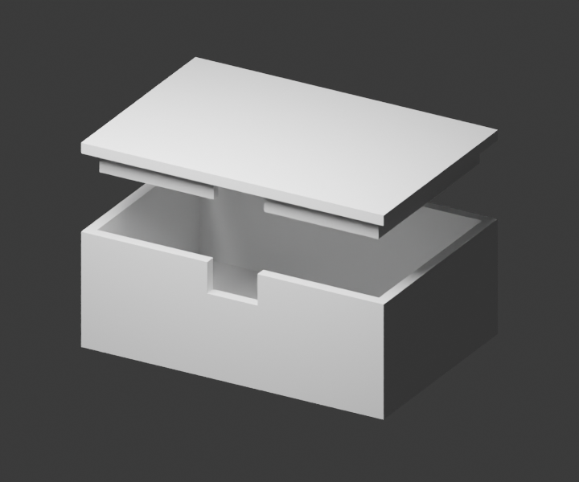

# PrintRelay agent kit

**CAD preflight and exact-spec quote requests for agents.** Give a coding or CAD agent a repeatable handoff from an exported model to a tracked manufacturing request.

This repository contains an Agent Skill, a Python standard-library client, an editable two-part enclosure workflow and an owned 20 mm test model. PrintRelay's beta can retain CAD, inspect STL geometry, pin manufacturing requirements and queue supplier quote work. A pending job is not a price. The beta does not collect payment or place orders, and geometry checks do not certify printability.

[Service and sign-in](https://printrelay.kva1.chatgpt.site) · [API guide](https://printrelay.kva1.chatgpt.site/docs) · [OpenAPI](https://printrelay.kva1.chatgpt.site/openapi.json) · [Current capabilities](https://printrelay.kva1.chatgpt.site/api/capabilities)

**Start here:** [first-run walkthrough](examples/quickstart.md). It separates a no-account local/public check from authenticated intake and tells you exactly where to stop while supplier quoting is unavailable.

**Free manufacturing guide:** [Will the lid fit?](knowledge/first-prototype-handoff.md) works through clearance versus tolerance, material/orientation questions and the information a CAD agent should preserve before requesting manufacture. Use it with any CAD tool or service; no account is needed.

## Install the skill

```sh
npx skills add KanishkVashisht/printrelay-agent-kit
```

Review the skill and choose the agent/client you want to configure. This is the owner/repository install syntax documented by the [skills CLI](https://www.skills.sh/docs/cli). Client support and permission prompts vary. Installing the skill does not create a PrintRelay account or authorize uploading a design.

You can also copy the entire [`skills/printrelay-hardware`](skills/printrelay-hardware) directory into your agent's supported skill directory. Keep `SKILL.md`, `scripts/printrelay.py` and `scripts/bootstrap_key.py`; the client needs the helper for key-file authentication. A direct service-hosted copy is available at [SKILL.md](https://printrelay.kva1.chatgpt.site/skills/printrelay-hardware/SKILL.md).

Skill installation does **not** install the repository's example models or tutorials. To run the examples, obtain a checkout separately:

```sh
git clone https://github.com/KanishkVashisht/printrelay-agent-kit.git
cd printrelay-agent-kit
```

The client and committed geometry checks use Python 3's standard library; no Python packages are needed. The first-run path was checked with Python 3.14.8 on macOS. Blender is needed only to regenerate or render the parametric enclosure.

## Start with a bounded task

> I have an STL for an electronics enclosure. Inspect its reported dimensions, preserve the explicit units and manufacturing requirements, and prepare a tracked quote request. Tell me what is missing and whether quotes are actually available. Do not order anything.

Use the agent's existing CAD tools to design or revise the part. This kit supplies the manufacturing handoff. Begin with a noncritical prototype, such as an enclosure fit check or desktop sensor mount.

## Inspect before creating an account

From a repository checkout, these read-only client commands need no API key and create no request:

```sh
python3 skills/printrelay-hardware/scripts/printrelay.py capabilities
python3 skills/printrelay-hardware/scripts/printrelay.py example
```

They read the service's current contract and a published measurement of the owned fixture. They do not quote your model or demonstrate supplier fulfillment. If the public route is unavailable, stop and check the deployment status in the API guide before uploading anything.

## Connect your account

Use the native PrintRelay OAuth connection to register a key generated and saved inside the named agent’s runtime, or create a key in the signed-in service console. Native registration receives only its SHA-256 digest. The [skill](skills/printrelay-hardware/SKILL.md#connect-a-named-external-agent-without-exposing-its-secret) includes the local bootstrap and retry procedure. Store the credential through your secret mechanism, or set `PRINTRELAY_API_KEY_FILE` to its private mode0600 file. Do not paste a key into an issue, commit, prompt or example file.

| Route | Authentication | Purpose |
| --- | --- | --- |
| Python client / REST | Account-scoped API key | Upload authorized CAD, read requests and preflight, retain specifications and request quote work. |
| `https://printrelay.kva1.chatgpt.site/api/mcp` | `Authorization: Bearer` followed by the same API key | External MCP clients that support Streamable HTTP and custom authentication headers. |
| Native PrintRelay app / `/mcp` | Sites OAuth through the native integration | Separate native installation route; the REST API key is not its OAuth credential. |

Check [capabilities](https://printrelay.kva1.chatgpt.site/api/capabilities) and [docs](https://printrelay.kva1.chatgpt.site/docs) before configuring a client. Production compatibility varies by host; a reachable endpoint is not proof of a completed authenticated workflow. The client uses a named User-Agent because the service edge rejects Python urllib's default agent string.

## Build a real CAD handoff

Start with the [parametric enclosure walkthrough](examples/enclosure/README.md): a 60 × 40 mm tray and lift-off lid, explicit clearances, a cable notch, editable Blender source, separate STL exports and measured geometry evidence. The example takes an agent from local CAD through preflight to two pinned specifications, stopping before any supplier upload or order. Its standalone verifier needs only Python's standard library; regenerating the model uses Blender.



## Try the smaller owned fixture

From a checkout of this repository:

```sh
python3 skills/printrelay-hardware/scripts/printrelay.py --help
```

Follow the [calibration workflow](examples/README.md). It explains the expected 20 × 20 × 20 mm dimensions, upload consent and a preflight-only stopping point. Keep request IDs and responses private. No supplier upload, purchase or print is required to try the fixture workflow.

For your own model, establish explicit mm/inch units, quantity, destination, process, exact material/allowed substitution policy, finish, color and manufacturing settings. Preserve functional notes. Accept supplier defaults only when that is the owner's explicit choice.

When quotes become available, compare only offers for the same specification and currency with complete shipping/tax, expiry, review status and delivery evidence. A production lead time is not a delivery promise. Named-provider file sharing requires the design owner's permission; PrintRelay uses persistent ordinary buyer accounts rather than guest checkout.

## Contents and scope

- `skills/printrelay-hardware/`: installable instructions and client; no third-party Python dependencies.
- `examples/enclosure/`: original parametric enclosure, exported components, reproducible checks and a CAD-agent handoff walkthrough.
- `examples/`: calibration geometry and expected measurements, with no customer data.
- `registry/server.json`: metadata for the [verified MCP Registry v0.3.0 listing](https://registry.modelcontextprotocol.io/v0.1/servers/io.github.KanishkVashisht%2Fprintrelay/versions/0.3.0). See `registry/README.md` for scope and verification.

The MIT license covers this repository's original code, documentation and generated fixture. It does not license the hosted service, third-party software, supplier content or user-uploaded designs. Report reproducible client issues without keys, addresses or private CAD. Follow the service's [privacy information](https://printrelay.kva1.chatgpt.site/privacy) for uploaded data.
