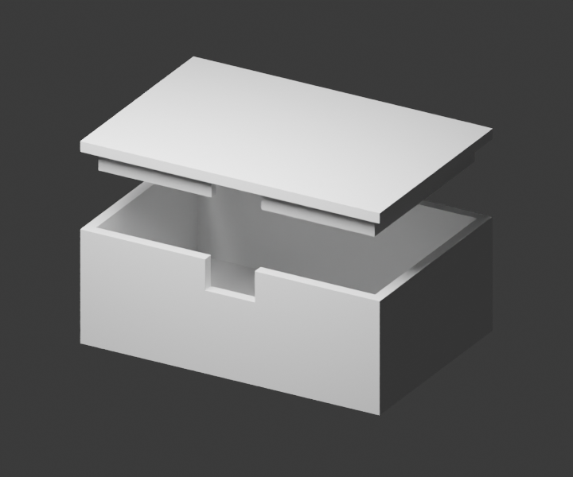

# CAD agent → enclosure → measured preflight

An original, editable enclosure for a **noncritical, unpowered electronics fit check**. Start with a useful two-part model, inspect the exported geometry, then let an agent prepare two exact manufacturing specifications. Stop there: this walkthrough does not share files with suppliers, request quotes, charge money, or start production.



The image is rendered from this source model. The lid is lifted 15 mm for visibility. No physical sample has been manufactured or fit-tested.

## Give your CAD agent a concrete task

> Use the PrintRelay agent kit's enclosure example as an editable starting point. Make a noncritical enclosure fit-check shell with 60 × 40 × 22 mm outer base dimensions, 2 mm walls and floor, a removable lid, and a centered 10 × 6 mm cable notch. Keep the nominal lid clearance at 0.3 mm per side. Export the two parts separately in explicit millimeters. Verify the exported dimensions and geometry. After I provide authorized account and destination details, upload the two parts to PrintRelay, inspect preflight, and pin exact specifications. Preserve the source revision and the two request IDs. Stop before supplier comparison or ordering.

For a different board, edit the parameters deliberately. Recompute the interior envelope, lip clearance and notch dimensions; update the requirements text and manufacturing choices before a new upload. Do not present the example's settings as recommendations for every enclosure.

## What is modeled

All lengths are **millimeters**. [`parameters.json`](parameters.json) is the editable dimension contract; [`enclosure.py`](enclosure.py) builds the solids in Blender with exact Boolean operations. It exports through Blender's STL exporter, rather than drawing an illustrative mesh for the page.

| Feature | Default | Meaning |
| --- | ---: | --- |
| Base exterior | 60 × 40 × 22 | X × Y × Z; origin at `[0, 0, 0]` |
| Wall / floor | 2 / 2 | Nominal design dimensions |
| Base cavity | 56 × 36 × 20 | Before the lid's locator lip occupies its upper perimeter |
| Lid plate | 60 × 40 × 2 | Loose lift-off cover, without snaps, screws, gasket or retention |
| Locator lip | 55.4 × 35.4 outer; 52.2 × 32.2 inner | 4 deep; 1.6 wall; cable relief interrupts the front lip |
| Lid clearance | 0.3 per side | **0.6 total** in each horizontal axis; nominal, not a fit guarantee |
| Cable notch | 10 wide × 6 down from the rim | Centered in the front wall, at Y = 0; not connector-specific |
| Exported lid bounds | 60 × 40 × 6 | Flat plate at Z = 0–2, locator lip at Z = 2–6 |
| Assembled exterior | 60 × 40 × 24 | Before any manufacturing variation |

The lip reduces the upper interior envelope. This model has no PCB mounting bosses, strain relief, seal or verified thermal/electrical behavior. A 50 × 30 mm **unpowered mock board** can be a starting fit-check target, but component heights and connector locations still need review. This is not a protective enclosure specification for powered electronics.

The lid is exported plate-down, lip-up. To position it mathematically on the base, transform each lid point as `(x, y, z) → (60 - x, y, 24 - z)` for the default parameters. This rotates the lid 180° about Y and preserves alignment of the centered front cable relief. The exported STL orientation is a modeling choice, not an instruction to transmit a print.

## Reproduce the export locally

Tested with **Blender 5.2.2 LTS** and Python's standard library. OpenSCAD, CadQuery and FreeCAD were unavailable in the authoring environment; no packages were installed. The parametric Blender source is authoritative. STL does not carry units: the exporter uses `global_scale=1`, `use_scene_unit=False`, +Y forward and +Z up, preserving the numerical millimeter coordinates. These are documented [Blender STL export options](https://docs.blender.org/api/5.1/bpy.ops.wm.html#bpy.ops.wm.stl_export).

From the repository root, with Blender on `PATH`:

```sh
# Rebuild local STL files. This makes no network or printer calls.
blender --background --factory-startup --python-exit-code 1 \
  --python examples/enclosure/enclosure.py

# Independently inspect the committed exports; no Blender needed for this step.
python3 examples/enclosure/verify.py --check

# Exercise rejection of a missing face and incorrect units.
python3 -m unittest discover -s examples/enclosure -p 'test_geometry.py' -v
```

`--python-exit-code 1` makes script exceptions fail the command; argument order follows the [Blender command-line interface](https://docs.blender.org/manual/en/latest/advanced/command_line/arguments.html). `--factory-startup` and background mode keep this separate from an open interactive project.

For an independent export without overwriting the checked-in files:

```sh
export PRINTRELAY_ENCLOSURE_BUILD="$(mktemp -d)"
blender --background --factory-startup --python-exit-code 1 \
  --python examples/enclosure/enclosure.py -- \
  --output-dir "$PRINTRELAY_ENCLOSURE_BUILD"
python3 examples/enclosure/verify.py \
  --directory "$PRINTRELAY_ENCLOSURE_BUILD" --check
```

Two exports on the tested Blender version produced identical STL SHA-256 hashes. A different Blender version may triangulate or serialize differently: a changed hash needs review, not automatic acceptance. `--check` intentionally requires the exact committed report. To inspect a deliberate revision, omit `--check`, review the resulting measurements, update the requirements, and record new evidence. Use `--parameters /path/to/parameters.json` on **both** commands when using a separate parameter file.

Optional preview generation uses the actual source geometry and Blender's CPU renderer:

```sh
blender --background --factory-startup --python-exit-code 1 \
  --python examples/enclosure/enclosure.py -- --render
```

## Measured evidence, with clear limits

[`geometry-report.json`](geometry-report.json) records measurements from the included independent standard-library verifier, with hashes of the STL, parameters, source and verifier. [`preflight.local.json`](preflight.local.json) records a **local invocation** of PrintRelay's geometry analyzer on the same bytes. It is not a response from a customer upload or evidence of any supplier interaction.

| Export | Bounds in mm | Triangles | Enclosed mesh volume |
| --- | --- | ---: | ---: |
| [`enclosure-base.stl`](enclosure-base.stl) | `[0,0,0]` to `[60,40,22]` | 44 | ≈ 12,360 mm³ |
| [`enclosure-lid.stl`](enclosure-lid.stl) | `[0,0,0]` to `[60,40,6]` | 72 | ≈ 5,857.28014 mm³ |

Both exports have one connected component, zero boundary/non-manifold edges, consistent winding, and zero duplicate or degenerate triangles in these checks. The independent verifier also compares volume with the analytic solids: 12,360 mm³ for the base and 5,857.28 mm³ for the lid; the small lid difference comes from exported floating-point coordinates.

`certifies_printability` remains **false**. The reports do not establish wall thickness, physical clearance, dimensional accuracy, self-intersection freedom, vertex manifoldness, support requirements, strength, safety or suitability. “Watertight edges” describes the surface mesh; the base is still an open-top vessel with a cable notch, and the assembly is not liquid-tight.

## Optional agent handoff: upload → preflight → exact spec

The local geometry steps above need no account. The following steps intentionally create private PrintRelay intake/specification records. Use them only when you intend that upload and have reviewed this example's choices. There are **two components, two requests and two fingerprints**; do not upload the lid as a second body in the base's file or call the pair quantity 2.

1. Read the [live capabilities](https://printrelay.kva1.chatgpt.site/api/capabilities) or run the client's `capabilities` command. Check that intake is available. This does not prove suppliers are connected.
2. Follow the [first-run account setup](../quickstart.md#connect-an-account-only-when-needed). Configure exactly one of `PRINTRELAY_API_KEY_FILE` (private mode0600 file) or `PRINTRELAY_API_KEY` (runtime secret store), then verify read-only `list` succeeds. Set your actual authorized `PRINTRELAY_CONTACT_EMAIL`, two-letter `PRINTRELAY_COUNTRY` and `PRINTRELAY_POSTAL_CODE`. Keep them and API responses out of Git; `.local/` is ignored by this kit.
3. Review [`base-requirements.txt`](base-requirements.txt), [`lid-requirements.txt`](lid-requirements.txt) and [`specification.example.json`](specification.example.json). The example explicitly chooses FDM, unfilled PLA without material-family substitution, any color, as-printed finish, 0.2 mm layers, 20% infill, and no arrival deadline. These are **exercise choices to accept or revise**, not inferred defaults or verified production recommendations. Updating parameters means updating these texts too.
4. Keep stable per-part upload keys. This local bootstrap creates keys only if the private file does not already exist:

```sh
mkdir -p .local/enclosure
python3 - <<'PY'
import json, uuid
from pathlib import Path
path = Path('.local/enclosure/upload-keys.json')
try:
    with path.open('x') as stream:
        json.dump({part: str(uuid.uuid4()) for part in ('base', 'lid')}, stream)
except FileExistsError:
    pass  # Resume the same exact file/requirements attempt; never replace retry keys.
PY
```

5. Upload each authorized part. Check each command's successful exit before proceeding. The client checks that the returned CAD SHA-256 matches the uploaded bytes.

```sh
python3 skills/printrelay-hardware/scripts/printrelay.py upload \
  examples/enclosure/enclosure-base.stl \
  --email "$PRINTRELAY_CONTACT_EMAIL" --material PLA --quantity 1 --units mm \
  --country "$PRINTRELAY_COUNTRY" --postal-code "$PRINTRELAY_POSTAL_CODE" \
  --notes "$(cat examples/enclosure/base-requirements.txt)" \
  --idempotency-key "$(python3 -c "import json; print(json.load(open('.local/enclosure/upload-keys.json'))['base'])")" \
  --consent > .local/enclosure/base-upload.json

python3 skills/printrelay-hardware/scripts/printrelay.py upload \
  examples/enclosure/enclosure-lid.stl \
  --email "$PRINTRELAY_CONTACT_EMAIL" --material PLA --quantity 1 --units mm \
  --country "$PRINTRELAY_COUNTRY" --postal-code "$PRINTRELAY_POSTAL_CODE" \
  --notes "$(cat examples/enclosure/lid-requirements.txt)" \
  --idempotency-key "$(python3 -c "import json; print(json.load(open('.local/enclosure/upload-keys.json'))['lid'])")" \
  --consent > .local/enclosure/lid-upload.json
```

An uncertain upload must be retried with the **same** bytes, fields and key. A changed model, destination, quantity, units, material family or requirements needs a new request and new persisted keys in a separate revision directory. Never regenerate keys merely because a response timed out. An error or missing ID stops the workflow.

6. Read both server preflights and compare their hashes/bounds to the local report. For the unmodified default example:

```sh
export PRINTRELAY_BASE_REQUEST_ID="$(python3 -c "import json; print(json.load(open('.local/enclosure/base-upload.json'))['id'])")"
export PRINTRELAY_LID_REQUEST_ID="$(python3 -c "import json; print(json.load(open('.local/enclosure/lid-upload.json'))['id'])")"
python3 skills/printrelay-hardware/scripts/printrelay.py preflight \
  "$PRINTRELAY_BASE_REQUEST_ID" > .local/enclosure/base-preflight.json
python3 skills/printrelay-hardware/scripts/printrelay.py preflight \
  "$PRINTRELAY_LID_REQUEST_ID" > .local/enclosure/lid-preflight.json
```

Expected extents: base `[60,40,22]`, lid `[60,40,6]`, explicitly in mm. Stop on a mismatched hash, dimensions, units, topology warning or unavailable preflight. The same workflow in MCP uses `upload_cad_request` and `get_cad_preflight`; inspect the current schemas in [`tools.json`](https://printrelay.kva1.chatgpt.site/tools.json) instead of inventing arguments.

7. After reviewing the results and accepting or revising the explicit choices, pin a specification for **each** request:

```sh
python3 skills/printrelay-hardware/scripts/printrelay.py specification \
  "$PRINTRELAY_BASE_REQUEST_ID" \
  --json-file examples/enclosure/specification.example.json \
  > .local/enclosure/base-specification.json
python3 skills/printrelay-hardware/scripts/printrelay.py specification \
  "$PRINTRELAY_LID_REQUEST_ID" \
  --json-file examples/enclosure/specification.example.json \
  > .local/enclosure/lid-specification.json
```

The server binds original CAD hash, material family, units, quantity, requirements and destination to each specification. The two fingerprints should differ because the parts differ. Save each returned fingerprint alongside its request ID, STL hash and model parameter revision. MCP's equivalent is `set_manufacturing_specification`. A 422 response means incomplete or invalid fields: correct those fields; do not pretend the spec was saved.

**Stop after the two saved specifications.** Report the actual request IDs and fingerprints privately, measurements, explicit choices and unresolved fit limitations. This exercise does not call `compare`, `request_provider_comparison`, supplier websites, payment services or printers. A future comparison requires separate permission to share each design with the named providers; an intake record or a positive geometry check is not an order.

## Files

- `enclosure.py` + `parameters.json`: editable parametric source and dimension contract.
- `enclosure-base.stl` + `enclosure-lid.stl`: default Blender exports, numerical mm coordinates.
- `verify.py` + `test_geometry.py`: independent offline measurement and rejection checks.
- `geometry-report.json` + `preflight.local.json`: measured evidence, hashes and limits.
- `enclosure-preview.png`: render of the actual source geometry, not a manufactured sample.
- `*-requirements.txt` + `specification.example.json`: explicit handoff inputs to review before use.

The repository's MIT license covers this original example. Blender and manufacturing providers remain independent projects/services; no affiliation is implied.
